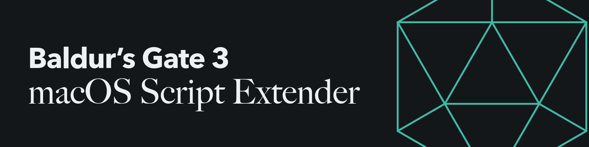

[](https://github.com/downcats/bg3mse/releases/latest)
[](https://www.nexusmods.com/baldursgate3)
[](https://ko-fi.com/downcats)

A macOS port of [Norbyte's Script Extender](https://github.com/Norbyte/bg3se), so the Baldur's Gate 3 mods that need it run on Apple Silicon Macs.

## Highlights

- **All SE mods, unchanged.** Mods that need the Script Extender run as they do on Windows, and their authors change nothing. Found one that doesn't? [Open an issue](https://github.com/downcats/bg3mse/issues).
- **Custom shaders.** A mod's Windows shaders are translated to Metal.
- **Multiplayer** with Windows players on Norbyte's extender.
- **Mod menus** in game, with controller support.
- **Achievements** stay on.
- **Double-click to install.** Doesn't touch the game's files.
- **Console and Lua debugger** [for mod authors](#for-mod-authors).
- **Optional:** [MetalFX Temporal](#metalfx-temporal) upscaling and [Native Camera Tweaks](#native-camera-tweaks).

## Installation

Only needed if a mod lists the Script Extender as a requirement. Requires an Apple Silicon Mac and Baldur's Gate 3 on Steam (Patch 8).

1. Download the [latest version](https://github.com/downcats/bg3mse/releases/latest) and open it.
2. Double-click **bg3mse**, pick any [optional features](#optional-features), click **Install**, then **Copy**.
3. In Steam, right-click Baldur's Gate 3 and choose **Properties**.
4. Paste the copied launch option into the **Launch Options** box under **General**.
5. Press **Play**.

## Where mods go

1. Put each mod's `.pak` file in:

   ```
   ~/Documents/Larian Studios/Baldur's Gate 3/Mods
   ```

   In Finder, use **Go > Go to Folder** and paste the path.

2. Enable the mod in the game's Mod Manager.

## Tested mods

These have been played on bg3mse and work:

| Mod | Version |
|---|---|
| Mod Configuration Menu | 1.41 |
| HomeBrew - Comprehensive Reworks | 9.2.7 |
| Trials of Tav - Reloaded | 2.3.5 |
| EasyCheat | 2.3.2 |
| Zerd's RAW | 5.2.0.0 |
| Combat Extender | 1.1.8 |
| Combat Extender AI | 1.1.5 |
| AI Allies | 1.5.16 |

This list isn't exhaustive. Other Script Extender mods should work too. If one doesn't, [open an issue](https://github.com/downcats/bg3mse/issues).

## Optional features

### MetalFX Temporal

Replaces FSR 1.0 with Apple's MetalFX Temporal upscaling.

- Turn on FSR in the game's video options.
- Requires macOS 13 or later.
- Sharpening is 0.3 by default (0 to 1). To change it, add to `bg3mse.conf`:

  ```
  gfx_temporal_sharpen = 0.5
  ```

### Native Camera Tweaks

A macOS port of ersh1's [BG3 Native Camera Tweaks](https://github.com/ersh1/BG3_NativeCameraTweaks).

- Tilt the camera and zoom out further.
- Controller: right stick up or down to tilt. Hold L3 to zoom instead.
- Mouse: hold the middle button and move up or down to tilt.
- Separate field of view and offset for exploration and combat.
- Settings are in `NativeCameraTweaks.toml` and apply live.

## Updating

bg3mse updates itself when the game starts. Updates come from this repo's releases and are signature-checked before use. Checking for updates is the only thing bg3mse goes online for.

To turn it off, put this in `ScriptExtenderUpdaterConfig.json` in [bg3mse's folder](#settings-and-logs):

```json
{ "DisableUpdates": true }
```

## Uninstalling

1. Open **bg3mse** and click **Uninstall**, or run [`bg3mse-install uninstall`](#commands).
2. Clear the game's **Launch Options** in Steam.

Settings are kept.

## If it doesn't work

- Check Launch Options in Steam. It should have the launch option and nothing else.
- Start the game from Steam, not Finder.
- Run [`bg3mse-install status`](#commands) to see whether bg3mse ran.
- Still stuck? [Open an issue](https://github.com/downcats/bg3mse/issues) and attach `logs/latest.log`.

## Settings and logs

Everything lives in `~/Library/Application Support/bg3mse`.

| Name | What it is |
|---|---|
| `bg3mse.conf` | bg3mse's own settings |
| `NativeCameraTweaks.toml` | Native Camera Tweaks' settings |
| `ScriptExtenderSettings.json` | The Script Extender's settings |
| `logs` | Logs. Attach `latest.log` to bug reports |
| `Crashes` | Crash reports, never sent anywhere. Attach the newest after a crash |

## Commands

In Terminal:

```bash
cd ~/Library/Application\ Support/bg3mse/bin
```

| Command | What it does |
|---|---|
| `./bg3mse-install status` | What's installed, which features are on, and when bg3mse last ran |
| `./bg3mse-install options` | Change optional features |
| `./bg3mse-install launch-option` | Print the Steam launch option |
| `./bg3mse-install uninstall` | Remove bg3mse, keep settings |
| `./bg3mse-install uninstall --purge` | Remove bg3mse and settings |

## For mod authors

Mods don't need a Mac version. If yours acts differently than on Windows, [open an issue](https://github.com/downcats/bg3mse/issues).

- **Settings.** `ScriptExtenderSettings.json` lives in `~/Library/Application Support/bg3mse`, not the game folder. [Same keys](https://github.com/Norbyte/bg3se#configuration) as on Windows.
- **Console.** Set `"CreateConsole": true`. The console opens in game; F6 toggles it.
- **Lua debugger.** Follow [Norbyte's guide](Docs/Debugger.md), with three changes:
  - The adapter is in `bg3mse-<version>-updater-payload.zip` on the release page. Set `program` to `lua-debugger/LuaDebugger` inside it.
  - Requires the [.NET 10 runtime](https://dotnet.microsoft.com/download/dotnet/10.0) for Arm64.
  - The game's `Data` folder is at `Baldur's Gate 3.app/Contents/Data`.

  Not tested from an editor yet.

## Building from source

Requires Xcode's command line tools, CMake 3.24 or later, and the [NoesisGUI Native SDK](https://www.noesisengine.com/) 3.1.7.

```bash
git clone https://github.com/downcats/bg3mse
cd bg3mse
./Mac/setup.sh
cmake -S . -B build -DBG3MSE_NOESIS_INCLUDE_DIR=/path/to/NoesisGUI-NativeSDK/Include
cmake --build build -j 4
./build/bg3mse-install install
```

Then set the launch option ([Installation](#installation), step 3).

Build options go on the first `cmake` line:

| Option | Default | What it does |
|---|---|---|
| `-DBG3MSE_NOESIS_INCLUDE_DIR=<dir>` | required | The `Include` folder of the NoesisGUI SDK |
| `-DBG3MSE_CAMERA=ON` | off | Builds Native Camera Tweaks |
| `-DBG3MSE_GFX=ON` | off | Builds the graphics fixes, including MetalFX Temporal |
| `-DBG3MSE_DOTNET=<path to dotnet>` | unset | Builds the Lua debug adapter. Needs the .NET 10 SDK |
| `-DBG3MSE_GAME_APP=<path to the game's .app>` | unset | Also tests against your copy of the game |

## Acknowledgements

- [Norbyte](https://github.com/Norbyte), for BG3SE, which makes all of this possible
- ersh1, for [BG3 Native Camera Tweaks](https://github.com/ersh1/BG3_NativeCameraTweaks), which the camera module is ported from
- AndrewTriesToCode, whose [bg3mfx](https://github.com/AndrewTriesToCode/bg3mfx) research the graphics fixes build on
- Larian Studios, for the game
- you, for using this

## License

Same license as the Script Extender: MIT with the Commons Clause (see [LICENSE](LICENSE)). The camera module in `Mac/Camera` is GPL-3.0-or-later.

The Mac port is AI-assisted: written with the help of Claude through Claude Code, directed and tested in game by me. The Script Extender itself is Norbyte's.

bg3mse is a fan project. It is not affiliated with or endorsed by Larian Studios or Wizards of the Coast.
